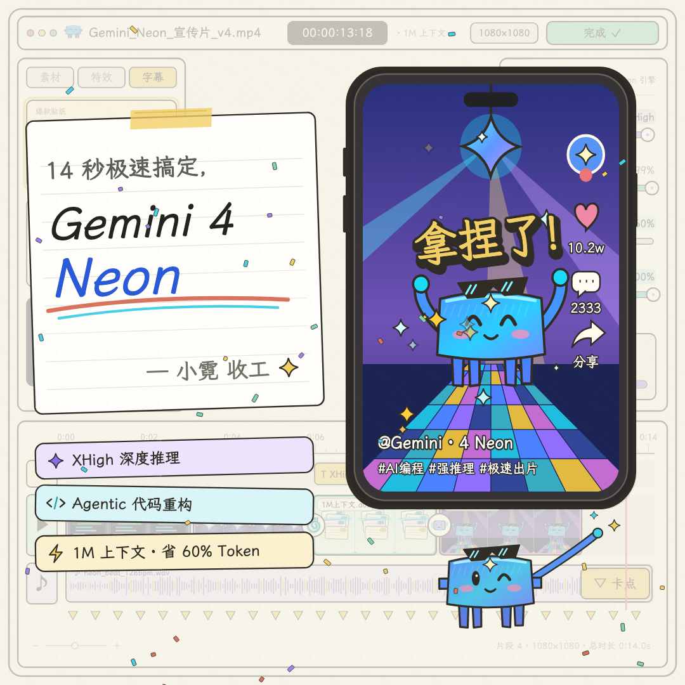

# Gemini 4 Neon · Remotion 手绘动效工程

基于 **Remotion v4（React + TypeScript）** 完整重构的 **1080×1080、30fps、14.0 秒（420 帧）** 奶油纸感手绘剪辑工坊风格宣传短片工程，100% 逐帧驱动（`useCurrentFrame` / `useVideoConfig` / `interpolate` / `Easing`），内嵌霞鹜文楷字体与 128 BPM 立体声配乐及卡点拟音。



## 规格参数

| 参数 | 数值 |
| --- | --- |
| Composition ID | `GeminiNeonPromo` |
| 分辨率 | `1080 × 1080` |
| 帧率 | `30 fps` |
| 总帧数 / 时长 | `420 frames`（`14.0s`） |
| 编码输出 | H.264（`yuv420p`，CRF 16）+ 立体声 AAC |
| 字体 | 霞鹜文楷 `LXGWWenKai-Regular.ttf` / `Medium.ttf`（SIL OFL 1.1） |
| 音频 | `public/audio/soundtrack.wav`（48kHz 立体声，128 BPM 原创配乐 + CC0 拟音） |

## 快速开始

### 1. 安装依赖

需要 **Node.js 20+**（推荐 Node 22）：

```bash
npm install
```

### 2. 启动 Remotion Studio 实时预览

```bash
npm run dev
```

启动后在浏览器中即可交互式预览每一帧、拖动时间轴、实时查看音频波形与画面卡点。

### 3. 渲染输出 MP4

```bash
npm run render
```

渲染完成后将在 `out/gemini-neon-promo.mp4` 生成 `1080×1080`、`30fps`、`14.0s` 的带音频成品 MP4。

### 4. 其他脚本

```bash
# TypeScript 静态类型检查
npm run typecheck

# 打包 Remotion Bundle
npm run build
```

## 目录结构

```text
.
├── docs/
│   └── preview.png                   # Remotion 渲染生成的结尾定格预览图（第 408 帧）
├── public/
│   ├── audio/
│   │   └── soundtrack.wav            # 14.0s 48kHz 立体声配乐与卡点音效
│   └── fonts/
│       ├── LXGWWenKai-Regular.ttf    # 霞鹜文楷常规体（weight 400）
│       └── LXGWWenKai-Medium.ttf     # 霞鹜文楷中等体（weight 700）
├── src/
│   ├── index.ts                      # Remotion 入口（registerRoot）
│   ├── Root.tsx                      # Composition 注册（1080×1080 / 30fps / 420 帧）
│   ├── GeminiNeonPromo.tsx           # 主合成组件（字体加载、音轨接入、虚拟镜头与图层编排）
│   ├── constants.ts                  # 配色方案、视频参数与卡片元数据
│   ├── fonts.ts                      # 基于 staticFile() + delayRender() 的字体加载器
│   ├── timeline.ts                   # 纯函数帧驱动状态机与虚拟镜头轨迹（stateAt / cameraAt）
│   └── components/
│       ├── SvgDefs.tsx               # SVG 渐变、斜线纹理、纸张颗粒与缩略图缓存
│       ├── Primitives.tsx            # 手绘风基础图元（Box / Label / Star / Heart / Sticker / Arm）
│       ├── NeonBot.tsx               # 原创手绘吉祥物「小霓 · Neon Bot」
│       ├── Artworks.tsx              # 4 组核心能力动态插画（代码重构 / 深度推理 / 1M 上下文 / Neon 舞台）
│       ├── Toolbar.tsx               # 顶部窗口栏、时间码与导出进度按钮
│       ├── Sidebar.tsx               # 左侧素材 / 特效 / 字幕切换面板
│       ├── SettingsPanel.tsx         # 右侧调参滑块与规格卡片
│       ├── PhonePreview.tsx          # 中央 / 结尾放大手机预览与特效滤镜
│       ├── TimelinePanel.tsx         # 底部三轨时间轴、剪辑切缝、音频波形与卡点标记
│       ├── EditorMascot.tsx          # 穿梭剪辑台的「小霓」拖拽、剪刀咔嚓、盖章与卡点热舞
│       ├── PencilIntro.tsx           # 开场铅笔手绘描边动效
│       └── EndingScene.tsx           # 11.65s–14.00s 结尾大特写、便利贴与彩带雨
├── package.json
├── remotion.config.ts
└── tsconfig.json
```

## 字体说明

项目已在 `public/fonts/` 内置霞鹜文楷（[LxgwWenKai v1.520](https://github.com/lxgw/LxgwWenKai/releases/tag/v1.520)，遵循 SIL Open Font License 1.1），通过 Remotion `staticFile()` 与 `delayRender()` 保证首帧渲染前完成加载，无字体闪烁或回退。
